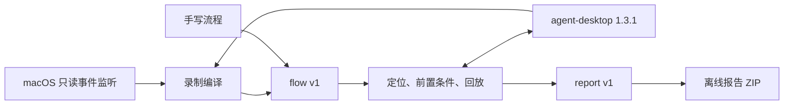

# Cuekeeper 架构

## M1 数据流

- `native/recorder.swift` 用 CGEventTap 在显式时限内监听鼠标和键盘。它先检查输入监控权限，只在指定应用位于前台时读取事件。可访问性树全部由 agent-desktop 读取。
- `native/recorder.swift` 只采集前台目标应用的键盘输入。鼠标点击按目标窗口命中判断，包含用来激活目标的首击。独立的键盘过滤器消费暂停和停止的组合键，普通按键原样传递。切换应用、暂停和点击 HUD 会结束当前文字段。两个 tap 预热且确认启用，窗口服务器确认主屏 HUD 后，录制才开始，停止时面板随之关闭。
- `src/record.ts` 读取录制开始时的窗口 ID，为点击及文字段首取快照。点击取包含事件坐标且层级最深的可操作节点，同层优先选面积更小的节点。文字根据焦点控件和时间间隙合并。受保护控件、无法及时观测的输入和不支持的操作会被跳过。权限丢失时停止采集。已捕获步骤按 v1 schema 写入，跳过与中断的原因由 CLI 返回。
- `src/desktop.ts` 调用 agent-desktop 的 JSON CLI。版本固定为 1.3.1，使用独立临时状态目录，退出时清理。文本经 stdin 传递。定位和执行分开，每次执行重新抓树并取得当次 ref。执行不自动重试。
- `src/run.ts` 将流程展开为动作，校验窗口和前置条件，执行业务动作。全局前置条件失败会阻塞整个流程，局部失败只阻塞所属动作。回放中的动作或断言失败会停止后续动作。报告保留投递状态，保存是否生效需要对应断言或外部文件核对。
- `src/pick.ts` 从只读窗口快照生成可交互元素优先的候选，并复用 `src/locator.ts` 的定位器生成规则。CLI `pick` 与工作台「重新拾取」共用该模块；它只读取快照，不点击、不聚焦。
- `src/report.ts` 校对流程摘要与动作顺序，再打包 `index.html`、`report.json`、`flow.json`、`manifest.json` 和可选的 `assets/`。清单记录每个归档内容文件的长度、SHA-256 以及资产与步骤的对应关系。`src/viewer.ts` 生成预渲染的静态查看器，时间线、失败展开、断言、日志和断流预览都在本地完成，不依赖网络。
- `src/doctor.ts` 提供只读环境自检与录制前预检：Node 版本、`dist/` 与 `workbench/` 文件、agent-desktop 1.3.1、录制器可执行性和辅助功能/输入监控状态。权限状态由录制器的 `--permissions` 预检返回，不触发系统弹框；`record` 在启动 agent-desktop 前调用同一套检查。`src/version.ts` 从 `build-info.json`（发布包）或 `package.json`（源码）读取版本。
- 分发产物由 `scripts/package.mjs` 组装：内置 Node 运行时、`dist/`、`workbench/`、预编译录制器和运行时依赖闭包，并生成两级校验和。细节见 [打包与分发](packaging.md)。

接口以 v1 契约为准。录制和回放绑定一个标题精确匹配的应用窗口；macOS 回放可在 setup 中按需启动应用或打开窗口。录制支持单次左键、ASCII 连续输入和常用快捷键。IME、拖拽、滚动、多窗口及系统对话框将在相应支持进入里程碑后验收。坐标以当前屏幕的逻辑点表示，回放会检查落点和窗口焦点，依然需要真实显示布局与无遮挡的测试窗口。保护字段判断依赖操作系统与控件提供的安全状态，测试流程请使用专用测试数据。录制与回放之间哪些操作只能部分一致、哪些差异会让报告「通过但做错」，以及检测方案和优先级见 [录制/回放一致性审计](fidelity.md)。

## v1 契约

`schemas/` 提供 flow、behavior、setup 和 report 四份 Draft-07 JSON Schema。相应示例放在 `examples/`。构建校验 Schema 与 `src/contracts.ts` 的生成结果一致。

- Flow 必须声明应用标识和精确窗口标题。动作包括 `click`、`type`、`key`、`wait` 与 `assert`。元素定位器用 `role`、可选 `name`、从窗口根开始的角色 `path` 和显式零基 `index` 组成。匹配采用精确比较，`name: ""` 表示无名称。多个命中且未指定序号时，回放会返回歧义错误。`point` 只用于点击，需要 `--headed`。
- `behavior` 是命名动作组。流程内可以把动作组放入 `behaviors`，用 `kind: "behavior"` 引用并提供 `args`。v1 支持在 `type.text` 中绑定字符串参数。独立 behavior 文件的 `version` 属于文件封装，嵌入流程时保留其余字段。编排者可在 JSON 中复制动作组或展开其动作。
- `setup` 可放在 flow 或 action 上。只有 `confirmed` 会参与回放，其他三态 `inferred`、`invalid` 和 `deleted` 在报告中记为跳过。独立 setup 文件嵌入时同样移除文件的 `version`。撤销属于工作台编辑功能。
- `src/setup.ts` 从流程目标与每个动作的应用/窗口推断建议：首次出现的应用生成 `app_running`，首次出现的窗口生成 `window_ready`，状态为 `inferred`，检查目标是窗口根元素的 `exists`。检查使用窗口根时，回放会按该元素名称绑定窗口，因此另一个应用的条件读取自己的窗口。已存在同应用/同窗口的条件（含失效与删除）不会重复推断。录制、导入工作台和保存测试项都复用这一模块：录制结果直接带推断条件，保存时只保留 `confirmed`。
- 给 setup 加上 `"ensure": { "kind": "app_running", "app": "com.apple.TextEdit", "timeout_ms": 15000 }` 可在检查未通过时启动应用。应用已经运行时复用该实例。
- `"ensure": { "kind": "window_ready", "app": "com.apple.TextEdit", "window": "Cuekeeper-M1.txt" }` 要求显式填写应用和精确窗口标题。setup 在该窗口上检查和复查，必要时先激活应用请求打开窗口，再按窗口 ID 聚焦。后续回放动作使用 `flow.target`。带 `--snapshot` 的离线 dry-run 加载主窗口的单窗口样本，遇到其他 setup 窗口时返回 `WINDOW_MISMATCH`。
- `timeout_ms` 可省略，默认为 15000，整数范围为 1000–120000。修复和复查共用时限。每轮修复只发出一次启动和一次聚焦请求，随后读取新快照并再次检查。回放始终核对已绑定的窗口 ID。dry-run 只解析定位器。实时修复可能将应用切到前台或触发系统授权提示。
- 检查支持 `exists`、`visible`、`text`、`value`。前两者要求布尔值，后两者与字符串精确比较。找不到目标只对 `exists: false` 构成匹配，模糊命中、快照缺失和不可读取的属性会明确失败。`wait` 定期重复读取，`assert` 读取一次。dry-run 只验证定位和作用域，结果记为 `resolved`。
- `assert` 额外支持窗口与区域截图断言：`check.target.kind: "window"` 配 `exists`、`title`（`equals` / `contains` / `matches`）或 `screenshot`（`region`、`baseline`、`maxDiffRatio`）。元素 `text` / `value` 同样支持三种比较与 `normalize`。这些扩展只挂在 `assert`；`wait` 与 `setup` 保持上面的四种属性与精确比较。`src/assertion.ts` 负责规划期校验、500 ms 正则预算和判定，`src/png.ts` 解码 PNG 并按固定区域逐像素比较，`src/desktop.ts` 增加只读的 `list-windows` 与 `screenshot`。窗口清单中的零匹配、歧义与读取失败分别映射为 `WINDOW_NOT_FOUND`、`AMBIGUOUS_TARGET` 和驱动错误码。
- 截图基线存为流程所在目录的 `baselines/<sha256>.png`，文件本身只包含裁剪区域；`baseline.frameWidth` / `frameHeight` 记录原窗口尺寸。失败证据写入 `<report>.assets/<展开步骤 ID>/assertion-baseline.png` 与 `assertion-actual.png`，`report pack` 会合并该目录并校验摘要与步骤引用。断言结果写在 report 条目的可选 `assertion` 字段（`expected`、`actual`、`screenshots`），旧报告省略该字段仍可打包与查看。工作台的「设为基线」读取整窗 PNG 路径与区域坐标，确认后裁剪落盘；当前实现不含画布圈选预览。
- Report 的 `mode` 区分 dry-run 与 replay。`entries` 记录动作、前置条件、相对时间、耗时和投递状态。报告以规范化 JSON 的 SHA-256 绑定原始 flow 内容。v1 的破坏性改动需要新版本和显式迁移。

## 里程碑

| 里程碑 | 可验收输出 |
| --- | --- |
| M1 · macOS 最小闭环 | CLI、v1 Schema 和离线 ZIP。TextEdit 录下三步并连续通过十轮保存核对 |
| M2 · 录制与工作台 | 应用筛选、时间线、元素拾取、行为复用与前置条件编辑。用一条录制会话完成整理、撤销和回放 |
| M3 · Windows 兼容与报告上传 | Windows 原生采集桥、同一 v1 流程格式、报告查看及可选幂等上传。本机保留上传失败的 ZIP |

`design/` 保存六份既有原型，供 M2 复用。执行协议以 [agent-desktop v1.3.1](https://github.com/vercel-labs/agent-desktop/tree/v1.3.1) 为准。

M3 的 Windows 可行性、与 macOS 的差异、驱动接口改动清单和实机待确认项见 [Windows 适配](windows.md)；首版做到哪一步、文件级实施拆分与稳定标题编辑器验收清单见 [Windows 首版（W1）范围决策](windows-scope.md)。
