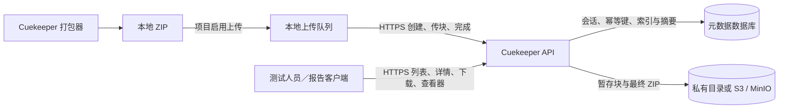

# 报告上传架构

Cuekeeper 保留离线报告流程。配置上传后，客户端将上传版 ZIP 写入本地队列，通过自建 API 续传。API 校验完整归档后才发布运行摘要。协议和字段见 [报告上传协议](upload-protocol.md)。

| 组件 | 职责与边界 |
| --- | --- |
| Cuekeeper 客户端 | 生成本地 ZIP，按项目规则生成上传版，持久化队列。依据服务端确认的字节数续传，失败保留 ZIP。只持有 Cuekeeper API token。 |
| Cuekeeper API 与元数据数据库 | 在单 workspace 内执行项目鉴权。数据库保证同项目同 ZIP 摘要唯一，并记录块进度、会话、运行摘要及产物到期时间。API 校验 ZIP 后才发布 `ready`，由受控模板提供查看器。 |
| 私有存储 | 使用自建服务节点上的持久目录，或由服务端连接的 S3/MinIO。保存未完成的块和校验后的 ZIP。对象键由服务生成，存储凭据留在服务端。 |

**提交边界。** 块落盘后才推进进度。最终 ZIP 写入私有存储后，数据库原子发布摘要与产物引用。客户端超时可用同一 SHA-256 重查。清理任务回收过期会话和没有引用的对象，运行摘要与幂等记录继续可查。

**读取边界。** API 为每次列表、下载和查看器请求检查 `runs:read`。原始 ZIP 作为附件流式返回，查看器仅渲染服务端校验过的结构化数据。到期时 API 停止提供两者，先于后台删除。

| 验收顺序 | 可观察结果 |
| --- | --- |
| 本地与自动上传 | 未配置时只生成本地 ZIP。配置后，同一打包入口自动入队，成功后列表出现一个可下载的 Run。 |
| 重试与续传 | 中断第二块后从最近确认边界恢复。模拟创建或完成响应丢失，再提交同一键，返回同一个 `runId`。 |
| 权限与保留 | 用其他项目的 token 被拒绝。到期后 ZIP 和查看器返回 `410`，列表与摘要仍可查询。 |
